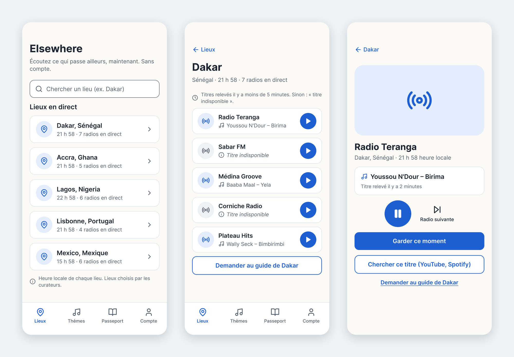

# Elsewhere

Discover radio stations from all over the world, and keep track of what you listen to.

> **Status: in progress.** Built solo, end to end, by Gabriel Laurent. A first usable version is due on December 14, 2026; the complete version is my project for the French state qualification in application development (RNCP37873, level 6) in March 2027.



*Mobile mockups of the first version: places, the live board of a place, and the player. All 13 screens, the navigation map and the accessibility choices are described in [`docs/els-7-maquettes.md`](docs/els-7-maquettes.md) (in French).*

## What it will do

- Explore stations by country on a world map, or let the app pick one at random
- Search stations, save favorites and build personal lists
- Keep a history of the tracks you listened to, read from the stream's own metadata
- An admin role to manage the station catalog, behind the app's own API

## One product rule: never a fake title

If a stream doesn't say what is playing, Elsewhere shows nothing rather than guessing.

Before building the player and the history, I tested whether stations actually send the artist and title. On 20 well-rated stations across five continents, only 6 sent a real title (30%), talk stations never did, and one automatic rule let a playlist name pass as a song. The decision and the full results are in [`docs/els-5-metadonnees-icy.md`](docs/els-5-metadonnees-icy.md) (in French), and the test can be rerun with [`scripts/test-icy-metadata.js`](scripts/test-icy-metadata.js).

## Stack

- **API**: Node.js and Express, in layers: routes, controllers, services, data access
- **Interface**: React with Vite
- **Database**: PostgreSQL hosted on Supabase, used as a database only. Authentication, access rules and validation are written in the Express API.
- **Station data**: the public [radio-browser.info](https://www.radio-browser.info/) directory

## How the work is run

- One Linear ticket, one short-lived branch, one pull request; `main` is protected
- Conventions for naming, commits, pull requests and the Definition of Done in [`CONTRIBUTING.md`](CONTRIBUTING.md)
- Instructions for AI coding agents in [`CLAUDE.md`](CLAUDE.md), with project skills in [`.claude/skills/`](.claude/skills/): implementing a user story, reviewing before a pull request, closing a work session
- Code names in English, code comments in French

## Repository layout

| Folder | Content |
| --- | --- |
| `api/` | Express API, with its tests and linter |
| `web/` | React interface, built with Vite |
| `prototype/` | Static graphic prototype (HTML, CSS, JavaScript) |
| `docs/` | Tests, decisions, mockups and the [work environment](docs/els-11-environnement.md) |
| `scripts/` | Rerunnable test scripts |

The application is being built ticket by ticket: for now, the API answers a health check and the interface shows a home page.

## Try it

```bash
git clone https://github.com/gvlaurent/elsewhere.git
cd elsewhere

# Open the graphic prototype in your browser
open prototype/index.html    # on Linux: xdg-open prototype/index.html

# Rerun the stream metadata test (Node.js 18 or later)
node scripts/test-icy-metadata.js
```

Run the application (Node.js 24 or later), in two terminals:

```bash
# API on http://localhost:3000
cd api && cp .env.example .env && npm install && npm run dev

# Interface on http://localhost:5173
cd web && npm install && npm run dev
```

## Author

Gabriel Laurent, ex-CPO turned product builder. [LinkedIn](https://www.linkedin.com/in/gabriel-laurent/) · [GitHub](https://github.com/gvlaurent)

Licensed under the terms in [`LICENSE`](LICENSE).
