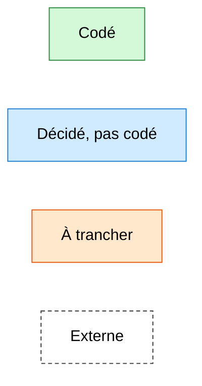
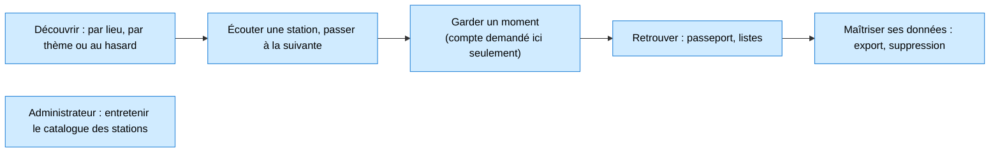
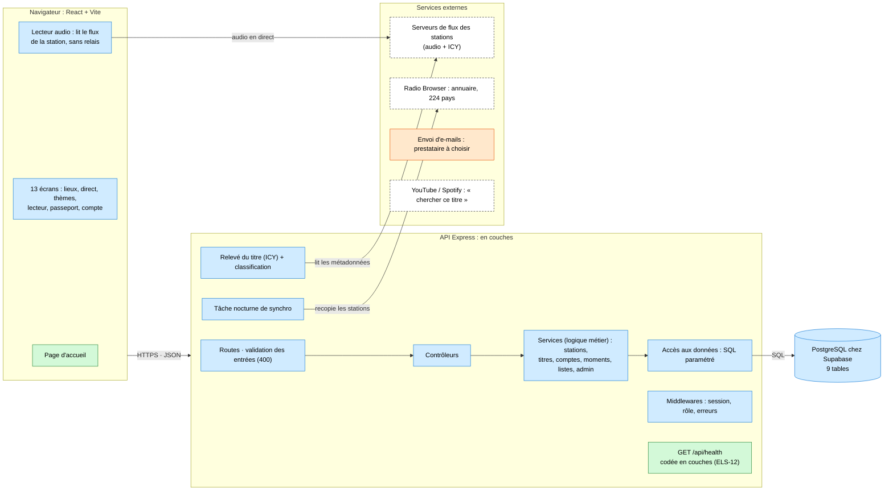
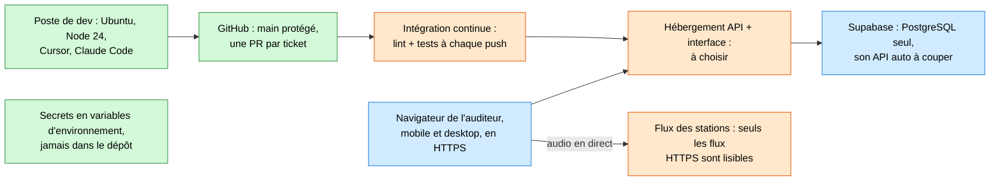
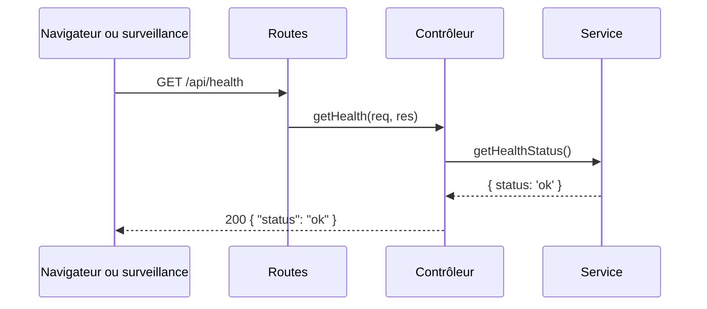
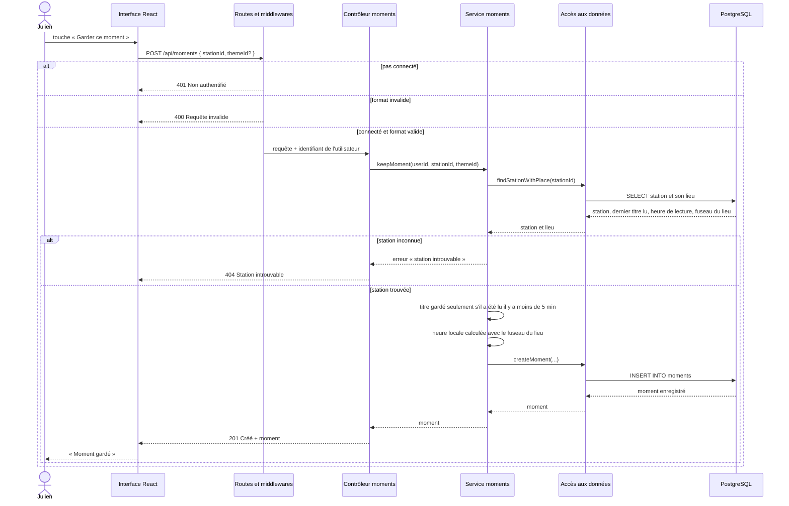

# Architecture d'Elsewhere

État au 12 novembre 2026 (ELS-12). Ce document décrit Elsewhere en quatre vues, du métier à l'infrastructure, puis détaille les couches de l'API et le déroulé de deux requêtes. Il complète la section 7 du PRD (`docs/prd.md`) et **il est mis à jour dans chaque pull request qui change l'architecture** (voir la dernière section).

## Pourquoi ce document

Le titre CDA demande de savoir **définir l'architecture logicielle** d'une application organisée en couches. Ce document en garde la preuve : quels processus l'application sert, quels blocs fonctionnels les portent, quels composants communiquent, et où tout cela tourne.

## Légende des statuts

Les schémas utilisent quatre couleurs, les mêmes partout :



## 1. Vue métier : les processus

Ce que fait un auditeur, dans l'ordre où il le vit. Le compte n'est demandé qu'au moment de garder un moment.



## 2. Vue fonctionnelle : quartiers et îlots

Les fonctions de l'application, regroupées par grand domaine (les « quartiers »). Les codes F et C renvoient au PRD.

| Découverte | Écoute | Mémoire du membre | Identité et données personnelles | Catalogue et administration |
| --- | --- | --- | --- | --- |
| Lieux et heure locale (F1) | Lecture du flux (F3) | Moments horodatés (F5) | Compte et connexion (F4) | Cache des stations (F9) |
| Tableau du direct (F1) | Radio suivante (F3) | Passeport par pays (F6) | Session, mot de passe oublié (C1) | Synchro nocturne (C10) |
| Thèmes (F2) | Titre en cours : jamais de faux titre | Listes personnalisées (F8) | Consentement à l'inscription (C2) | Masquer / réactiver (F10) |
| Surprends-moi : tirage côté API | Signaler une station en panne (C8) | Raccourcis (F11) | Export et suppression (F7) | Rôles vérifiés par l'API |

Toutes ces fonctions sont décidées et aucune n'est encore codée.

## 3. Vue applicative : composants et flux

Qui parle à qui. Le navigateur ne parle qu'à l'API d'Elsewhere, et seule l'API parle à la base.



- **Le son ne passe pas par l'API** : le lecteur lit directement le flux de la station, sans relais, pour ne pas surcharger le serveur. Conséquence encore à trancher : une page en HTTPS ne peut lire que des flux en HTTPS (vue technique).
- **Le navigateur ne parle jamais à l'annuaire** (C11) : l'API recopie les stations chaque nuit et les sert depuis sa base.
- **Supabase sert uniquement de base** : authentification, règles d'accès et validation sont codées dans l'API.

## 4. Vue technique : où ça tourne



Le détail des outils et de leurs versions est dans `docs/els-11-environnement.md`.

## Les couches de l'API

Chaque requête traverse quatre couches. Chacune n'a qu'un seul rôle et n'appelle que la couche juste en dessous.

| Couche | Dossier | Son rôle | Ce qu'elle ne fait jamais |
| --- | --- | --- | --- |
| Routes | `api/src/routes/` | Associer une adresse et un verbe HTTP à un contrôleur. Brancher les middlewares : vérifier que la personne est connectée (401) et que les données reçues ont le bon format (400). | Décider d'une règle métier |
| Contrôleurs | `api/src/controllers/` | Lire la requête HTTP, appeler le service, traduire son résultat en réponse et en code HTTP | Décider d'une règle métier, écrire du SQL |
| Services | `api/src/services/` | Porter la logique métier : les règles d'Elsewhere, comme « jamais de faux titre », et **les droits** (un moment n'est visible que par son propriétaire, une action d'admin exige le rôle admin) | Connaître HTTP (`req`, `res`), écrire du SQL |
| Accès aux données | `api/src/repositories/` | Lire et écrire dans la base, avec des requêtes SQL paramétrées | Décider d'une règle métier |

Deux contrôles d'accès se complètent :

- **l'authentification** répond à « qui es-tu ? ». Elle est vérifiée à l'entrée, par un middleware branché sur la route ;
- **l'autorisation** répond à « as-tu le droit de toucher à ça ? ». Elle est vérifiée dans le service, parce qu'elle dépend des données (à qui appartient ce moment ?).

**Pourquoi ce découpage.** Une règle métier qui change ne touche que le service. Un changement de base ne touche que l'accès aux données. Un service, qui ne connaît pas HTTP, peut se tester sans lancer de serveur.

### Arborescence

```text
api/src/
├── server.js                 démarre l'API sur un port
├── app.js                    crée l'application, branche toutes les routes sous /api
├── routes/
│   ├── index.js              rassemble les routes de chaque ressource
│   └── health-routes.js
├── controllers/
│   └── health-controller.js
├── services/
│   └── health-service.js
└── repositories/             arrive avec la connexion à la base (ELS-16)
```

Chaque ressource (santé, stations, moments…) a un fichier dans chaque couche, nommé `<ressource>-<couche>.js`, en kebab-case comme le veut `CONTRIBUTING.md`.

### Exemple réel : la route de santé

`GET /api/health` est la première route codée. Elle ne touche pas la base : le service répond seul, pour qu'un incident de base ne fasse pas croire que l'API elle-même est arrêtée.



## Déroulé d'une fonctionnalité : garder un moment (F5)

Julien écoute une station de Lagos et touche « Garder ce moment ». Le moment conserve le lieu, la station, l'heure locale, le titre s'il est lisible et le thème d'entrée s'il existe.



**Les choix visibles dans ce schéma :**

- **Le titre est lu par l'API, jamais envoyé par le navigateur.** Le navigateur n'envoie que l'identifiant de la station. Sinon, n'importe qui pourrait enregistrer un titre inventé, ce qui contredirait la règle « jamais de faux titre ».
- **La règle des 5 minutes vit dans le service.** C'est une règle métier : ni la route, ni le contrôleur, ni l'accès aux données ne la connaissent.
- **Chaque refus a son code HTTP et sa couche** : 401 et 400 à l'entrée (route et middlewares), 404 quand le service ne trouve pas la station, 201 quand le moment est créé.
- **L'accès aux données utilise des requêtes paramétrées** : les valeurs reçues ne sont jamais collées dans le texte SQL, ce qui protège des injections SQL.

**À préciser plus tard :**

- Le fonctionnement exact de la session (cookie, durée) sera décidé avec l'authentification (ELS-17).
- Le cas « sans compte » de F5 (créer le compte puis garder le moment sans ressaisie) sera détaillé avec la story correspondante.

## Tenir ce document à jour

Ce document décrit l'état réel du projet. Il est mis à jour **dans la pull request même** qui change l'un de ces éléments :

- un statut (un bloc passe de « décidé » à « codé », ou une question « à trancher » est tranchée) ;
- une couche, un middleware, une ressource de l'API ou une table ;
- un service externe ou un choix d'hébergement ;
- le déroulé d'une requête décrite ci-dessus.

Le schéma d'ensemble du `README.md` est un résumé de la vue applicative : il suit les mêmes changements. La date « État au » en tête de ce document est mise à jour à chaque fois.
