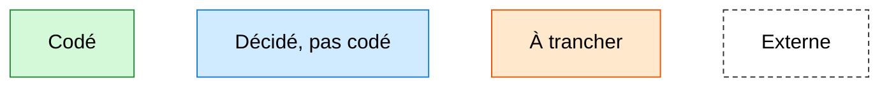
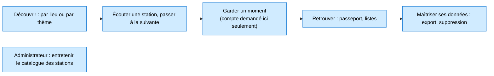
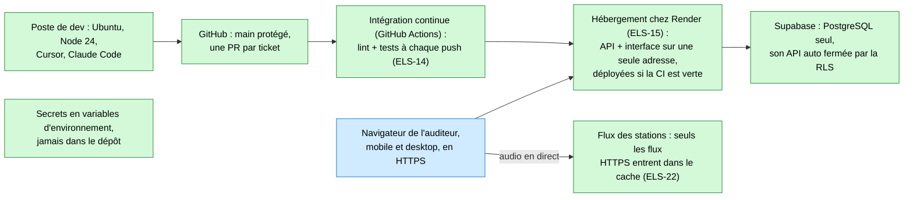
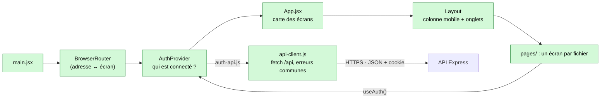
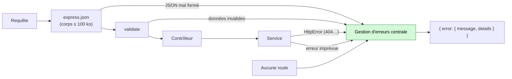
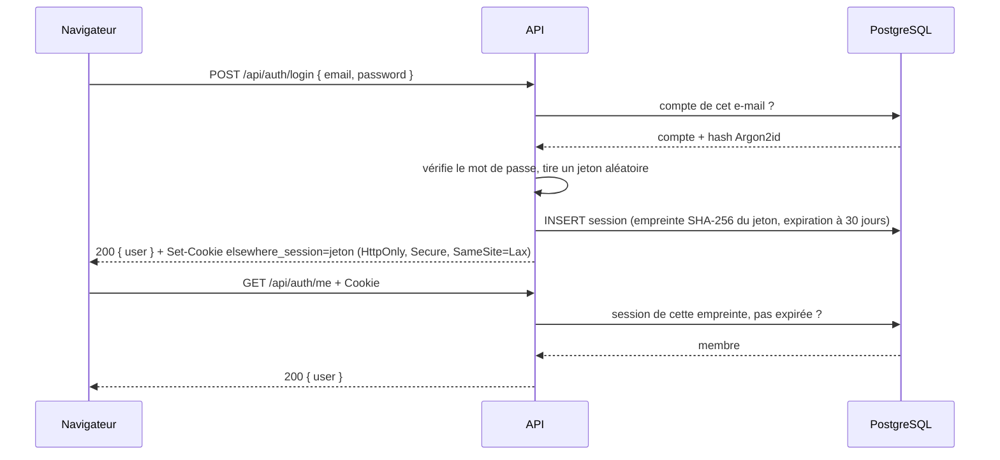
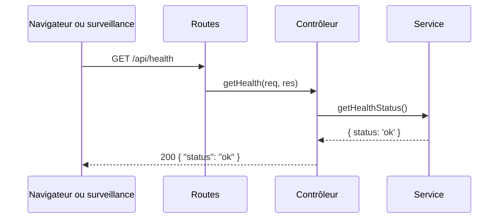
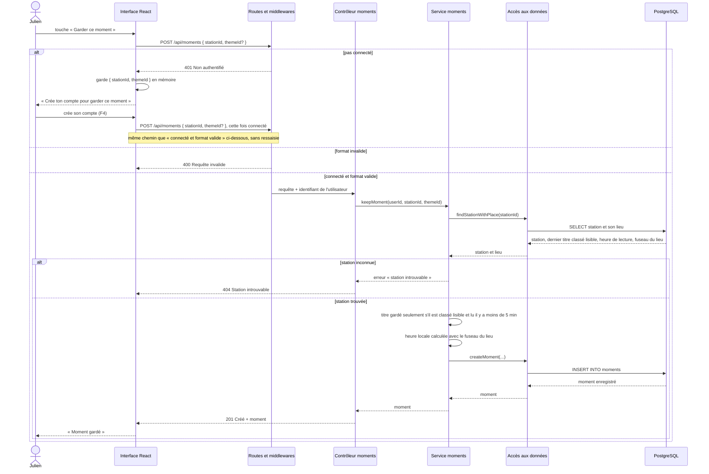

# Architecture d'Elsewhere

État au 28 novembre 2026 (ELS-22, ELS-21 et ELS-18). Ce document décrit Elsewhere en quatre vues, du métier à l'infrastructure, puis détaille les couches de l'API et le déroulé de deux requêtes. Il complète la section 7 du PRD (`docs/prd.md`) et **il est mis à jour dans chaque pull request qui change l'architecture** (voir la dernière section).

## Pourquoi ce document

Le titre CDA demande de savoir **définir l'architecture logicielle** d'une application organisée en couches. Ce document en garde la preuve : quels processus l'application sert, quels blocs fonctionnels les portent, quels composants communiquent, et où tout cela tourne.

## Légende des statuts

Les schémas utilisent quatre couleurs, les mêmes partout :



## 1. Vue métier : les processus

Ce que fait un auditeur, dans l'ordre où il le vit. Le compte n'est demandé qu'au moment de garder un moment.



## 2. Vue fonctionnelle : quartiers et îlots

Les fonctions de l'application, regroupées par grand domaine (les « quartiers »). Les codes F et C renvoient au PRD.

| Découverte | Écoute | Mémoire du membre | Identité et données personnelles | Catalogue et administration |
| --- | --- | --- | --- | --- |
| Lieux et heure locale (F1) | Lecture du flux (F3) | Moments horodatés (F5) | Compte et connexion (F4) | Cache des stations (F9) |
| Tableau du direct (F1) | Radio suivante (F3) | Passeport par pays (F6) | Session, mot de passe oublié (C1) | Synchro nocturne (C10) |
| Thèmes (F2) | Titre en cours : jamais de faux titre | Listes personnalisées (F8) | Consentement à l'inscription (C2) | Masquer / réactiver (F10) |
| | Signaler une station en panne (C8) | Raccourcis (F11) | Export et suppression (F7) | Rôles vérifiés par l'API |

Le compte, la connexion (F4), la déconnexion de C1 et le consentement à l'inscription (C2) sont codés : l'API avec ELS-17, les écrans avec ELS-21 et ELS-18. Le remplissage du cache des stations (F9) est codé sous forme d'une commande lancée à la main (ELS-22) ; la tâche de chaque nuit viendra avec ELS-37. Les autres fonctions sont décidées, pas encore codées.

## 3. Vue applicative : composants et flux

Qui parle à qui. Le navigateur ne parle qu'à l'API d'Elsewhere, et seule l'API parle à la base.

```mermaid
flowchart LR
    subgraph NAV["Navigateur : React + Vite"]
        direction TB
        N0["Socle : navigation (React Router),<br/>mise en page, appel à l'API,<br/>état « qui est connecté » (ELS-21)"]:::code
        N1["Écrans codés : accueil, inscription<br/>avec consentement, connexion, compte"]:::code
        N2["Écrans : lieux, direct, thèmes, lecteur,<br/>passeport (maquettes ELS-7)"]:::decide
        N3["Lecteur audio : lit le flux<br/>de la station, sans relais"]:::decide
    end

    subgraph API["API Express : en couches"]
        direction TB
        A1["Routes · validation des entrées (400)"]:::code
        A2["Contrôleurs"]:::code
        A3["Services (logique métier) : titres,<br/>moments, listes, admin<br/>+ droits d'accès"]:::decide
        A3b["Service des comptes : inscription,<br/>connexion, déconnexion (ELS-17)"]:::code
        A3c["Service d'importation des stations :<br/>HTTPS seulement, hors ligne et doublons<br/>écartés, rattachement au lieu (ELS-22)"]:::code
        A4["Accès aux données : SQL paramétré<br/>(comptes, sessions, lieux, stations)"]:::code
        A4b["Client Radio Browser : serveurs par DNS,<br/>délai maximal (ELS-22)"]:::code
        A10["Commande npm run stations:import<br/>(ELS-22)"]:::code
        A1 --> A2 --> A3 --> A4
        A2 --> A3b --> A4
        A10 --> A3c --> A4
        A3c --> A4b
        A5["Middleware de session requireAuth :<br/>qui es-tu ? (401) ; essais limités (429)"]:::code
        A9["Erreurs centrales : 400, 404, 500"]:::code
        A6["Relevé du titre (ICY) + classification"]:::decide
        A7["Tâche nocturne de synchro<br/>(ELS-37, réutilise l'importation)"]:::decide
        A8["GET /api/health<br/>codée en couches (ELS-12)"]:::code
    end

    DB[("PostgreSQL chez Supabase<br/>9 tables + sessions,<br/>migrations 001 et 002")]:::code

    subgraph EXT["Services externes"]
        direction TB
        X1["Serveurs de flux des stations<br/>(audio + ICY)"]:::externe
        X2["Radio Browser : annuaire,<br/>224 pays (ELS-6)"]:::externe
        X3["Envoi d'e-mails : prestataire à choisir"]:::trancher
        X4["YouTube / Spotify : « chercher ce titre »"]:::externe
    end

    NAV -- "HTTPS · JSON" --> API
    A4 -- "SQL" --> DB
    N3 -- "audio en direct" --> X1
    A6 -- "lit les métadonnées" --> X1
    A4b -- "recopie les stations<br/>(HTTPS · JSON)" --> X2
    A7 -.-> A3c

    classDef code fill:#d3f9d8,stroke:#2b8a3e,color:#000
    classDef decide fill:#d0ebff,stroke:#1c7ed6,color:#000
    classDef trancher fill:#ffe8cc,stroke:#e8590c,color:#000
    classDef externe fill:#ffffff,stroke:#333333,stroke-dasharray:4 3,color:#000
```



- **Le son ne passe pas par l'API** : le lecteur lit directement le flux de la station, sans relais, pour ne pas surcharger le serveur. Conséquence, tranchée avec ELS-22 : une page en HTTPS ne peut lire que des flux en HTTPS, donc seules les stations à flux `https://` entrent dans le cache (environ 30 % des stations en ligne sont écartées pour cette raison, [ADR-0005](adr/0005-importation-des-stations-depuis-radio-browser.md)).
- **Le navigateur ne parle jamais à l'annuaire** (C11) : l'API recopie les stations dans sa base et les sert depuis là. Aujourd'hui par la commande `npm run stations:import` (ELS-22), demain chaque nuit (ELS-37).
- **Supabase sert uniquement de base** : authentification, règles d'accès et validation sont codées dans l'API. Son API automatique est fermée : la sécurité par ligne (RLS) est activée sur chaque table, sans aucune règle (voir `docs/donnees.md`).

## 4. Vue technique : où ça tourne



Le détail des outils et de leurs versions est dans `docs/els-11-environnement.md`.

**L'intégration continue** (`.github/workflows/ci.yml`) rejoue à chaque push, sur une machine neuve de GitHub Actions, ce qu'on lance en local : ESLint et les tests pour l'API, ESLint, les tests et la construction pour l'interface. Les tests de base visent Supabase dans un schéma jetable, avec l'adresse de la base rangée dans le secret GitHub `DATABASE_URL` ; sans ce secret, ils sont sautés. Une PR ne peut être fusionnée que si ces deux contrôles sont verts (règle de protection de `main`).

**L'hébergement** est décrit dans `render.yaml` ([ADR-0003](adr/0003-hebergement-sur-render.md)) : l'API (`elsewhere-api`, Node 24, Francfort) et l'interface (`elsewhere-web`, site statique) sont chez Render. Le navigateur ne connaît qu'une adresse, celle de l'interface : Render y transmet `/api/*` à l'API, comme Vite le fait en développement. Les deux services ne se déploient qu'après une CI verte sur `main` ; l'API lance la migration de la base à son démarrage. Adresse de préproduction : <https://elsewhere-web-ifej.onrender.com>.

## L'interface React

L'interface est servie en fichiers statiques. Elle ne parle qu'à l'API, toujours par `/api/...` à sa propre adresse, et toujours par un seul module (`api/api-client.js`). Les choix sont expliqués dans l'[ADR-0006](adr/0006-routage-et-organisation-de-l-interface.md).



| Adresse | Écran | Maquette |
| --- | --- | --- |
| `/` | Accueil (en-tête des lieux) | 01 |
| `/inscription` | Créer un compte, avec la case de consentement non cochée (C2) | 08 |
| `/connexion` | Se connecter | 09 |
| `/compte` | Mon compte : e-mail, date du consentement, déconnexion | 12 (partie) |
| toute autre | Page introuvable | |

- **Qui est connecté** : au chargement, `AuthProvider` appelle `GET /api/auth/me` (200 : le membre ; 401 : personne). Le cookie de session est `HttpOnly` : seule l'API sait s'il est valide. Les écrans de compte affichent « Chargement… » jusqu'à la réponse, puis redirigent si besoin. Une réponse de `/me` arrivée après une connexion ou une inscription réussie est ignorée. L'onglet « Compte » mène au compte ou à la connexion selon la réponse.
- **Les erreurs de l'API** sont placées par `forms/form-errors.js` : un champ fautif (400, ou 409 pour l'e-mail déjà inscrit) a son message sous le champ, relié par `aria-describedby`, et reçoit le focus ; les autres (401, 429, 500, réseau coupé) s'affichent en tête du formulaire, dans une zone `role="alert"` lue par les lecteurs d'écran. Les erreurs sont vidées à chaque envoi (une erreur identique est ainsi annoncée de nouveau), et celle d'un champ disparaît dès qu'on le modifie.
- **Le consentement** est vérifié deux fois : l'écran bloque l'envoi tant que la case n'est pas cochée, et l'API exige `consent: true` et enregistre la date, prise sur le serveur. Son texte dit seulement ce qui est gardé (l'e-mail, la date de l'accord, puis les moments et les listes) ; il parlera de l'export et de la suppression quand ELS-40 les aura codés.

```text
web/src/
├── main.jsx                  point d'entrée : routeur, état de connexion, App
├── App.jsx                   la carte des écrans (adresse → écran)
├── index.css                 styles communs, couleurs nommées des maquettes
├── api/
│   ├── api-client.js         le seul appel à fetch : /api, JSON, cookie, ApiError
│   ├── api-client.test.js
│   ├── auth-api.js           inscription, connexion, déconnexion, qui est connecté
│   └── auth-api.test.js
├── auth/
│   ├── auth-context.js       le contexte et le crochet useAuth()
│   ├── AuthProvider.jsx      demande /api/auth/me au chargement, garde le membre
│   └── AuthProvider.test.jsx une réponse tardive de /me n'efface pas un membre qui vient d'entrer
├── components/
│   ├── Layout.jsx            mise en page commune : écran + barre d'onglets
│   ├── Layout.test.jsx       onglets selon qui est connecté, page introuvable
│   ├── TabBar.jsx            onglets Lieux et Compte
│   ├── BackLink.jsx          « ← Retour »
│   ├── TextField.jsx         champ accessible : étiquette, aide, erreur
│   ├── FormAlert.jsx         erreur en tête de formulaire (role="alert")
│   └── Icon.jsx              icônes SVG décoratives
├── forms/
│   ├── form-errors.js        place une erreur de l'API sous son champ ou en tête ; focus sur le premier fautif
│   └── use-form-errors.js    état des erreurs d'un formulaire : vider, afficher, retirer celle d'un champ modifié
├── pages/
│   ├── HomePage.jsx
│   ├── RegisterPage.jsx      inscription et consentement (ELS-18)
│   ├── RegisterPage.test.jsx
│   ├── LoginPage.jsx
│   ├── LoginPage.test.jsx
│   ├── AccountPage.jsx       e-mail, date du consentement, déconnexion
│   ├── AccountPage.test.jsx
│   └── NotFoundPage.jsx
├── test-setup.js             préparation de Vitest (jsdom, nettoyage)
└── test-utils.jsx            outils des tests : fausse API, application en mémoire
```

## Les couches de l'API

Chaque requête traverse quatre couches. Chacune n'a qu'un seul rôle et n'appelle que la couche juste en dessous.

| Couche | Dossier | Son rôle | Ce qu'elle ne fait jamais |
| --- | --- | --- | --- |
| Routes | `api/src/routes/` | Associer une adresse et un verbe HTTP à un contrôleur. Brancher les middlewares : vérifier que la personne est connectée (401) et que les données reçues ont le bon format (400). | Décider d'une règle métier |
| Contrôleurs | `api/src/controllers/` | Lire la requête HTTP, appeler le service, traduire son résultat en réponse et en code HTTP | Décider d'une règle métier, écrire du SQL |
| Services | `api/src/services/` | Porter la logique métier : les règles d'Elsewhere, comme « jamais de faux titre », et **les droits** (un moment n'est visible que par son propriétaire, une action d'admin exige le rôle admin) | Connaître HTTP (`req`, `res`), écrire du SQL |
| Accès aux données | `api/src/repositories/` | Lire et écrire dans la base, avec des requêtes SQL paramétrées | Décider d'une règle métier |

Deux contrôles d'accès se complètent, chacun dans une seule couche :

- **l'authentification** répond à « qui es-tu ? ». Elle est vérifiée à l'entrée, par un middleware branché sur la route ;
- **l'autorisation** répond à « as-tu le droit de toucher à ça ? ». Elle est vérifiée dans le service, parce qu'elle dépend des données (à qui appartient ce moment ?). Le rôle admin en fait partie : le middleware dit seulement qui est connecté, le service décide si ce compte a le droit d'agir.

**Pourquoi ce découpage.** Une règle métier qui change ne touche que le service. Un changement de base ne touche que l'accès aux données. Un service, qui ne connaît pas HTTP, peut se tester sans lancer de serveur.

### Arborescence

```text
api/src/
├── server.js                 crée le pool de la base et démarre l'API sur un port
├── app.js                    createApp({ db }) : crée l'application, range le pool, branche les routes sous /api
├── routes/
│   ├── index.js              rassemble les routes de chaque ressource
│   ├── health-routes.js
│   ├── auth-routes.js        /api/auth : inscription, connexion, déconnexion, me
│   └── auth-routes.test.js   les comptes de bout en bout, dont les tests de sécurité
├── middlewares/
│   ├── validate.js           vérifie params, query et body avec un schéma Zod (400)
│   ├── validate.test.js
│   ├── require-auth.js       session valide exigée, sinon 401 ; range le membre dans req.user
│   ├── login-rate-limit.js   au-delà de 10 échecs de connexion par e-mail en 15 min : 429
│   ├── not-found.js          route inconnue sous /api (404)
│   ├── error-handler.js      gestion d'erreurs centrale, branchée en dernier
│   └── error-handler.test.js
├── errors/
│   └── http-error.js         erreur prévue, qui porte son code HTTP
├── config/
│   ├── zod.js                Zod réglé en français ; tout schéma importe z d'ici
│   ├── session.js            durée de la session, nom et options du cookie
│   ├── starting-places.js    les 6 lieux de départ, leur fuseau et leurs alias (ELS-22)
│   └── starting-places.test.js
├── controllers/
│   ├── health-controller.js
│   └── auth-controller.js    pose et efface le cookie de session
├── services/
│   ├── health-service.js
│   ├── health-service.test.js   test du service seul, sans serveur
│   ├── auth-service.js       règles des comptes, jeton de session et son empreinte
│   ├── password-hashing.js   hachage Argon2id des mots de passe, 4 calculs à la fois au plus
│   ├── password-hashing.test.js
│   ├── limit-concurrency.js  file d'attente : au plus N tâches asynchrones en même temps
│   ├── limit-concurrency.test.js
│   ├── station-selection.js  règles du tri des stations : lieu, hors ligne, HTTPS, doublons
│   ├── station-selection.test.js   sur des stations simulées, sans base ni réseau
│   ├── stations-import-service.js   annuaire → tri → base, en une transaction
│   └── stations-import-service.test.js   annuaire simulé : en erreur, trop lent, 2e importation
├── clients/
│   ├── radio-browser-client.js   l'annuaire Radio Browser : serveurs par DNS, délai, User-Agent
│   └── radio-browser-client.test.js   faux fetch et faux DNS : aucun appel réseau
├── commands/
│   ├── import-stations.js    npm run stations:import : lance l'importation, affiche le rapport
│   └── import-stations.test.js
├── repositories/
│   ├── users-repository.js   comptes : créer, chercher par e-mail (SQL paramétré)
│   ├── users-repository.test.js   dont la preuve contre l'injection SQL
│   ├── sessions-repository.js   sessions : créer, retrouver le membre, supprimer
│   ├── sessions-repository.test.js
│   ├── places-repository.js  lieux : créer ou mettre à jour (ON CONFLICT)
│   ├── places-repository.test.js
│   ├── stations-repository.js   stations : insérer ou mettre à jour sans doublon (ON CONFLICT)
│   └── stations-repository.test.js
├── db/
│   ├── pool.js               connexion à PostgreSQL (réserve de connexions, TLS vérifié)
│   ├── pool.test.js
│   ├── migrate.js            applique les migrations dans l'ordre (npm run db:migrate)
│   ├── transaction.js        withTransaction : plusieurs écritures en tout ou rien
│   ├── transaction.test.js
│   ├── migrations/
│   │   ├── 001_initial_schema.sql   les 9 tables, contraintes, index, déclencheur, RLS
│   │   └── 002_sessions.sql      la table des sessions de connexion (ELS-17)
│   ├── postgres-error-codes.js   noms des codes d'erreur de PostgreSQL (23505…)
│   ├── schema.test.js        les 10 tables et les contraintes du modèle
│   └── start-database-for-tests.js  schéma jetable pour chaque fichier de test
├── app.test.js               l'application assemblée : santé, 404, 400, 413, 415
└── start-app-for-tests.js    outils des tests (port libre, envoi de JSON et de cookies)
```

Chaque ressource (santé, stations, moments…) a un fichier dans chaque couche, nommé `<ressource>-<couche>.js`, en kebab-case comme le veut `CONTRIBUTING.md`.

Deux dossiers ne sont pas des couches de requête HTTP :

- `clients/` appartient à la couche d'accès aux données, mais pour une source extérieure : un client sait parler à un service du dehors (ici Radio Browser) et ne décide d'aucune règle métier ;
- `commands/` contient les commandes lancées à la main avec `npm run`. Comme un contrôleur, une commande ne fait que brancher les vraies dépendances (pool, client) sur un service et mettre son résultat en forme.

### Accès aux données et base

La couche d'accès aux données est la seule à écrire du SQL. Chaque fonction reçoit en premier le pool de connexions (`db`). `server.js` crée le pool et le passe à `createApp({ db })`, qui le range dans `app.locals` ; un contrôleur le lit dans `req.app.locals.db` et le passe au service, qui le passe à l'accès aux données. Un test fabrique son application avec le pool de sa base jetable.

```js
export async function findUserByEmail(db, email) {
  const { rows } = await db.query(
    'SELECT ... FROM users WHERE lower(email) = lower($1)',
    [email],
  );
  return rows[0] ?? null;
}
```

- **Toujours des requêtes paramétrées** : le texte SQL contient des repères `$1`, `$2`, et les valeurs voyagent à part. PostgreSQL ne les lit jamais comme du SQL. Un test le prouve : chercher l'e-mail `' OR 1=1 --` ne renvoie personne.
- **Le modèle de données** (MCD, MLD, dictionnaire, choix des suppressions en cascade) est décrit dans [`docs/donnees.md`](donnees.md).
- **Les migrations** sont des fichiers SQL numérotés, appliqués une seule fois par `npm run db:migrate` ([ADR-0001](adr/0001-migrations-en-sql-pur.md)). Les tests les rejouent dans un schéma jetable sur Supabase ([ADR-0002](adr/0002-tests-de-base-dans-un-schema-jetable.md)).
- **La connexion est chiffrée et vérifiée** avec le certificat de Supabase (`DATABASE_CA_CERT`) ; sans lui, l'API refuse de se connecter à une base distante.

### Validation des entrées et erreurs

Chaque route qui reçoit des données branche le middleware `validate` avant son contrôleur, avec un schéma [Zod](https://zod.dev) par endroit de la requête. `z` est toujours importé de `config/zod.js`, qui règle les messages en français :

```js
import { z } from '../config/zod.js';

router.post(
  '/:id/reports',
  validate({
    params: z.object({ id: z.coerce.number().int().positive() }),
    body: z.object({ reason: z.string().min(3) }),
  }),
  createReport,
);
```

- **Le contrôleur ne lit que `req.validated`**, qui ne contient que des données vérifiées et converties (`"42"` devient `42`). Un champ inattendu envoyé par le client est retiré.
- **Toutes les erreurs sont listées ensemble**, avec l'endroit (`params`, `query`, `body`), le champ et un message en français : le client corrige tout en une fois. `field` vaut `null` quand c'est l'ensemble qui est faux (un tableau envoyé à la place d'un objet).

Toutes les erreurs sous `/api` repartent au même format, quelle que soit la couche qui les a lancées :

```json
{ "error": { "message": "Requête invalide", "details": [
  { "location": "body", "field": "reason", "message": "Trop petit : …" }
] } }
```



| Cas | Code | Message envoyé au client |
| --- | --- | --- |
| Données invalides (`validate`) | 400 | Requête invalide, avec les champs fautifs |
| Corps JSON mal formé | 400 | JSON mal formé |
| Corps trop gros ou mal encodé | 413, 415 | Requête refusée |
| Pas de session valide (`requireAuth`) | 401 | Connexion requise |
| Trop d'échecs de connexion (`login-rate-limit`) | 429 | Trop de tentatives de connexion… |
| Erreur prévue d'un service (`HttpError`) : identifiants faux, e-mail déjà inscrit… | son code (401, 409…) | son message |
| Route inconnue sous `/api` | 404 | Ressource introuvable |
| Erreur imprévue, y compris un code 4xx posé par une autre bibliothèque | 500 | Erreur interne du serveur |

**Une erreur imprévue ne laisse rien fuiter.** Son détail (message technique, pile d'appels, adresse de la base) part seulement dans les journaux du serveur : le client ne reçoit que le message générique, qui ne donne aucune prise à un attaquant. Une `HttpError` 5xx lancée par un service est montrée telle quelle, mais aussi journalisée.

**Limites connues.** Le compteur des échecs de connexion vit dans la mémoire du serveur : il repart à zéro au redémarrage. L'inscription n'est pas encore limitée en nombre (à revoir avec ELS-42). Hors de `/api`, Express répond encore avec sa page HTML par défaut : l'interface est servie à part, par le site statique de Render (ELS-15). Si une réponse a déjà commencé à partir quand une erreur survient, on ne peut plus la changer : Express coupe la connexion.

### Authentification et sessions

Les comptes (F4) et la déconnexion (C1) sont codés dans l'API. Les choix sont expliqués dans l'[ADR-0004](adr/0004-sessions-en-base-et-cookie.md).

| Route | Middlewares | Réponse |
| --- | --- | --- |
| `POST /api/auth/register` `{ email, password, consent }` | `validate` | 201 `{ user }` + cookie ; 409 si l'e-mail a déjà un compte |
| `POST /api/auth/login` `{ email, password }` | `validate`, limite des essais | 200 `{ user }` + nouveau cookie ; 401 ; 429 après 10 échecs |
| `POST /api/auth/logout` | | 204, session supprimée en base, cookie effacé |
| `GET /api/auth/me` | `requireAuth` | 200 `{ user }` ; 401 |



- **Le mot de passe n'est jamais stocké**, seulement son hash Argon2id. **Le jeton de session non plus**, seulement son empreinte : une copie volée de la base ne permet de se connecter à aucun compte.
- **Le cookie est hors de portée du JavaScript** (`HttpOnly`), envoyé seulement en HTTPS (`Secure`), et pas quand un autre site déclenche une requête (`SameSite=Lax`, contre le CSRF).
- **La déconnexion supprime la session en base** : un cookie copié ne sert plus à rien (C1).
- **La connexion ne révèle pas qui est inscrit** : e-mail inconnu et mauvais mot de passe reçoivent la même réponse 401, en un temps comparable.
- **Une route protégée** branche `requireAuth` avant son contrôleur et lit le membre dans `req.user`. Les droits (« ce moment est-il à toi ? ») restent vérifiés dans le service.

### Importation des stations (ELS-22)

La commande `npm run stations:import` (depuis `api/`) remplit le cache des stations pour les lieux de `config/starting-places.js`. Elle n'a pas de route HTTP : elle est lancée à la main, et la tâche de chaque nuit (ELS-37) appellera le même service. Les choix sont expliqués dans l'[ADR-0005](adr/0005-importation-des-stations-depuis-radio-browser.md).

```mermaid
sequenceDiagram
    participant K as Commande stations:import
    participant S as Service d'importation
    participant RB as Client Radio Browser
    participant X as Radio Browser
    participant T as Tri (station-selection)
    participant D as Repositories lieux et stations
    participant B as PostgreSQL
    K->>S: importStations(pool, { client, places })
    loop un appel par pays (SN, NG, GH, CO, TR, PT)
        S->>RB: searchStationsByCountry('NG')
        RB->>X: GET /json/stations/bycountrycodeexact/NG (User-Agent Elsewhere/0.1, 10 s max)
        X-->>RB: stations brutes
        RB-->>S: stations réduites aux champs utiles
    end
    Note over S,RB: un serveur en panne ou trop lent : on essaie le suivant ; tous en panne : erreur, rien n'est écrit
    S->>T: selectStations(stations par pays, lieux)
    T-->>S: par lieu : stations gardées + écartées par raison
    S->>D: BEGIN, puis upsertPlace et upsertStations pour chaque lieu
    D->>B: INSERT … ON CONFLICT … (SQL paramétré)
    S->>D: COMMIT
    S-->>K: rapport
    K->>K: affiche gardées et écartées, lieu par lieu et pays par pays
```

- **Seuls les flux `https://` entrent dans le cache** : une page en HTTPS ne peut pas lire un flux en `http://`.
- **L'annuaire est joint sans serveur codé en dur** : la liste vient du DNS ; si elle est vide ou si le DNS échoue, le client se replie sur `all.api.radio-browser.info`, le nom officiel qui répartit les demandes.
- **Une station est rattachée à un lieu par alias, « la région d'abord, sinon le nom »** : si son champ libre `state` est rempli, il doit contenir l'un des alias du lieu ; s'il est vide, c'est le nom de la station qui doit en contenir un. Toujours dans le pays du lieu, sans tenir compte des majuscules ni des accents. Sinon elle est écartée comme « lieu inconnu », comptée par pays. Un `state` rempli qui ne correspond pas n'est jamais rattrapé par le nom.
- **Pas de doublon** : à l'intérieur d'une importation (même identifiant, même flux, même nom dans un lieu), et d'une importation à l'autre (`ON CONFLICT (external_id)`).
- **Une station masquée par un admin le reste** : l'importation ne touche jamais au statut.
- **Limites connues** : une station qui disparaît de l'annuaire reste dans le cache jusqu'à la synchro de chaque nuit (ELS-37). Le repli sur le nom peut rattacher par erreur une station sans région dont le nom cite une ville où elle n'émet pas ; elle reste dans le bon pays.

### Exemple réel : la route de santé

`GET /api/health` est la première route codée. Elle ne touche pas la base : le service répond seul, pour qu'un incident de base ne fasse pas croire que l'API elle-même est arrêtée.



## Déroulé d'une fonctionnalité : garder un moment (F5)

Julien écoute une station de Lagos et touche « Garder ce moment ». Le moment conserve le lieu, la station, l'heure locale, le titre s'il est lisible et le thème d'entrée s'il existe.



**Les choix visibles dans ce schéma :**

- **Le titre est lu par l'API, jamais envoyé par le navigateur.** Le navigateur n'envoie que l'identifiant de la station. Sinon, n'importe qui pourrait enregistrer un titre inventé, ce qui contredirait la règle « jamais de faux titre ».
- **Deux filtres protègent du faux titre.** Le relevé du titre (bloc A6) ne stocke un titre qu'après l'avoir classé lisible : sans ce tri, la règle actuelle laisserait passer 29 % de faux titres (PRD, écart n° 5). Puis le service ne garde ce titre que s'il a moins de 5 minutes. Ces deux règles métier vivent dans les services : ni la route, ni le contrôleur, ni l'accès aux données ne les connaissent.
- **Sans compte, le moment n'est pas perdu.** Le navigateur garde la station et le thème pendant l'inscription, puis renvoie la même requête : l'auditeur ne ressaisit rien (F5).
- **Chaque refus a son code HTTP et sa couche** : 401 et 400 à l'entrée (route et middlewares), 404 quand le service ne trouve pas la station, 201 quand le moment est créé.
- **L'accès aux données utilise des requêtes paramétrées** : les valeurs reçues ne sont jamais collées dans le texte SQL, ce qui protège des injections SQL.

**À préciser plus tard :**

- Où le navigateur garde le moment en attente pendant l'inscription (mémoire de la page ou stockage local) sera décidé avec la story F5.

## Tenir ce document à jour

Ce document décrit l'état réel du projet. Il est mis à jour **dans la pull request même** qui change l'un de ces éléments :

- un statut (un bloc passe de « décidé » à « codé », ou une question « à trancher » est tranchée) ;
- une couche, un middleware, une ressource de l'API ou une table ;
- un service externe ou un choix d'hébergement ;
- le déroulé d'une requête décrite ci-dessus.

Le schéma d'ensemble du `README.md` est un résumé de la vue applicative : il suit les mêmes changements. La date « État au » en tête de ce document est mise à jour à chaque fois.
