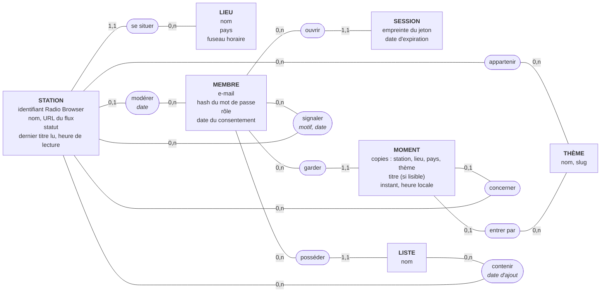
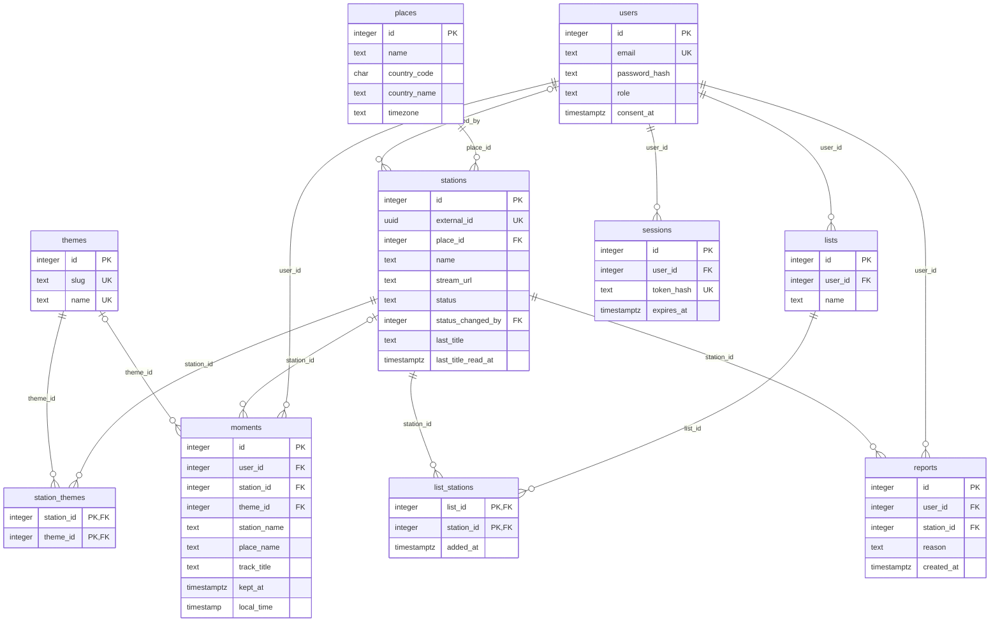

# Données d'Elsewhere : MCD, MLD et dictionnaire

État au 28 novembre 2026 (ELS-17). Ce document décrit la base PostgreSQL d'Elsewhere, du modèle conceptuel au script SQL. Il suit l'arbitrage du 11 novembre (ELS-63, `docs/prd.md` section 7) : **9 tables** pour le métier, dont deux liaisons plusieurs à plusieurs, plus une table technique, `sessions` (ELS-17).

Les scripts qui créent la base sont [`001_initial_schema.sql`](../api/src/db/migrations/001_initial_schema.sql) (les 9 tables) et [`002_sessions.sql`](../api/src/db/migrations/002_sessions.sql) (les sessions), dans `api/src/db/migrations/`. En cas d'écart, ce sont eux qui font foi, et ce document est corrigé.

## Pourquoi ce document

Le titre CDA demande de savoir **concevoir et mettre en place une base de données relationnelle**. La démarche suit la méthode Merise, en trois étapes :

1. **MCD** (modèle conceptuel) : ce que l'application doit retenir, en mots du métier, sans penser technique.
2. **MLD** (modèle logique) : la traduction en tables, colonnes et clés.
3. **Script SQL** (modèle physique) : les types exacts, les contraintes et les index, dans une migration versionnée.

## 1. Modèle conceptuel (MCD)

Les rectangles sont les **entités** (ce qu'on retient), les ovales les **associations** (les liens entre elles). Les **cardinalités** sur chaque trait se lisent depuis l'entité : `0,n` veut dire « au minimum 0, au maximum plusieurs ».



**Règles de gestion** qui justifient ces cardinalités :

- Une station se situe dans **un seul** lieu ; un lieu peut n'avoir aucune station en cache (`1,1` / `0,n`).
- Une station a plusieurs thèmes, un thème couvre plusieurs stations (`0,n` des deux côtés : liaison plusieurs à plusieurs).
- Un moment est gardé par **un seul** membre (`1,1`). Il concerne au plus une station et au plus un thème (`0,1`) : le lien peut disparaître si la station quitte le cache, ou si l'auditeur est entré par un lieu.
- Une liste appartient à **un seul** membre (`1,1`) ; une liste contient plusieurs stations et une station peut être dans plusieurs listes.
- Un membre signale une station **au plus une fois** (C8) : le couple (membre, station) est unique.
- Une station garde la trace du **dernier** admin qui l'a masquée ou réactivée (`0,1`), avec la date (C9).
- Une session appartient à **un seul** membre (`1,1`) ; un membre a une session par appareil connecté, ou aucune (`0,n`).

**Ce que le MCD ne contient pas, et pourquoi :**

- **Pas d'historique des titres** (ancienne entité `track_plays`) : aucune fonctionnalité n'en a besoin. Le tableau du direct n'utilise que le dernier titre de moins de 5 minutes, porté par la station ; le titre à retrouver est copié dans le moment (ELS-63).
- **Pas encore de jeton de réinitialisation** du mot de passe : il viendra avec la réinitialisation par e-mail (ELS-39), dans une nouvelle migration.

## 2. Modèle logique (MLD)

Chaque entité devient une table. Une association `1,1` devient une **clé étrangère** (une colonne qui pointe vers la clé d'une autre table). Une association `0,n`–`0,n` devient une **table de liaison**, dont la clé primaire est faite des deux clés étrangères.

Notation : la clé primaire est **soulignée**, une clé étrangère est précédée de `#`.

- **places** (<u>id</u>, name, country_code, country_name, timezone, created_at)
- **users** (<u>id</u>, email, password_hash, role, consent_at, created_at)
- **stations** (<u>id</u>, external_id, #place_id, name, stream_url, homepage_url, status, status_changed_at, #status_changed_by, last_title, last_title_read_at, created_at, updated_at)
- **themes** (<u>id</u>, slug, name)
- **station_themes** (<u>#station_id, #theme_id</u>)
- **moments** (<u>id</u>, #user_id, #station_id, #theme_id, station_name, place_name, country_code, country_name, theme_name, track_title, kept_at, local_time)
- **lists** (<u>id</u>, #user_id, name, created_at)
- **list_stations** (<u>#list_id, #station_id</u>, added_at)
- **reports** (<u>id</u>, #user_id, #station_id, reason, created_at)
- **sessions** (<u>id</u>, #user_id, token_hash, created_at, expires_at)

`reports` a sa propre clé `id`, alors que c'est une association : un signalement sera désigné seul par l'admin (« traiter le signalement 42 »). L'unicité du couple (membre, station) est gardée par une contrainte `UNIQUE`.



*Le schéma ne montre que les colonnes principales ; la liste complète est dans le dictionnaire ci-dessous.*

## 3. Dictionnaire des données

Types PostgreSQL utilisés : `integer` (entier), `text` (texte sans longueur imposée), `char(2)` (exactement 2 caractères), `uuid` (identifiant universel), `timestamptz` (instant précis, stocké en UTC), `timestamp` (date et heure sans fuseau).

### places : les lieux (F1)

| Colonne | Type | Obligatoire | Règle | Description |
| --- | --- | --- | --- | --- |
| id | integer | oui | clé primaire, auto-incrémentée | Identifiant du lieu |
| name | text | oui | non vide ; unique dans un pays | Nom de la ville ou de la région (Lagos) |
| country_code | char(2) | oui | deux majuscules (ISO 3166-1) | Code du pays (NG) |
| country_name | text | oui | | Nom du pays (Nigeria) |
| timezone | text | oui | nom IANA | Fuseau horaire (Africa/Lagos), pour l'heure locale |
| created_at | timestamptz | oui | par défaut : maintenant | Date d'ajout |

### users : les comptes (F4, C2)

| Colonne | Type | Obligatoire | Règle | Description |
| --- | --- | --- | --- | --- |
| id | integer | oui | clé primaire | Identifiant du membre |
| email | text | oui | contient un @ ; unique sans tenir compte de la casse | Adresse de connexion |
| password_hash | text | oui | | Hash du mot de passe ; le mot de passe lui-même n'est jamais stocké |
| role | text | oui | `member` ou `admin` ; par défaut `member` | Rôle vérifié par l'API à chaque action d'admin (F10) |
| consent_at | timestamptz | oui | | Date à laquelle le membre a accepté l'usage de ses données (C2) |
| created_at | timestamptz | oui | par défaut : maintenant | Date d'inscription |

### stations : les stations en cache (F1, F9, F10)

| Colonne | Type | Obligatoire | Règle | Description |
| --- | --- | --- | --- | --- |
| id | integer | oui | clé primaire | Identifiant interne |
| external_id | uuid | oui | unique | Identifiant de la station chez Radio Browser, pour la synchro nocturne |
| place_id | integer | oui | → places ; un lieu qui a des stations ne peut pas être supprimé | Lieu de la station |
| name | text | oui | non vide | Nom affiché |
| stream_url | text | oui | | Adresse du flux audio |
| homepage_url | text | non | | Site de la station |
| status | text | oui | `active` ou `hidden` ; par défaut `active` | Une station masquée par l'admin n'est plus proposée |
| status_changed_at | timestamptz | non | | Date du dernier masquage ou de la dernière réactivation (C9) |
| status_changed_by | integer | non | → users ; devient vide si ce compte est supprimé | Admin auteur de ce changement (C9) |
| last_title | text | non | rempli avec last_title_read_at, ou vide avec lui | Dernier titre lu **et classé lisible** ; jamais un faux titre |
| last_title_read_at | timestamptz | non | idem | Heure de cette lecture, pour la règle des 5 minutes |
| created_at | timestamptz | oui | par défaut : maintenant | Date d'entrée dans le cache |
| updated_at | timestamptz | oui | par défaut : maintenant ; remise à l'heure courante par un déclencheur à chaque modification | Date de la dernière modification (synchro, modération) |

Les lieux et les stations sont remplis par la commande `npm run stations:import` (ELS-22, [ADR-0005](adr/0005-importation-des-stations-depuis-radio-browser.md)) : elle crée ou met à jour les lieux de départ (`ON CONFLICT (country_code, name)`), puis leurs stations (`ON CONFLICT (external_id)`), sans jamais toucher au statut choisi par un admin. `stream_url` ne contient que des adresses en `https://`.

Le **déclencheur** (*trigger*) `stations_set_updated_at` est une fonction que PostgreSQL lance tout seul avant chaque modification d'une station : la date de mise à jour reste juste même si le code qui modifie la station oublie de la changer.

### themes : la liste fermée des thèmes (F2)

| Colonne | Type | Obligatoire | Règle | Description |
| --- | --- | --- | --- | --- |
| id | integer | oui | clé primaire | Identifiant du thème |
| slug | text | oui | unique ; minuscules, chiffres et tirets | Nom dans les URL (`rock-turc`) |
| name | text | oui | unique | Nom affiché (Rock turc) |

La liste des thèmes sera remplie par une migration, avec la story F2 : c'est une liste fermée, que l'administrateur ne modifie pas depuis l'application.

### station_themes : liaison stations ↔ thèmes (F2)

| Colonne | Type | Obligatoire | Règle | Description |
| --- | --- | --- | --- | --- |
| station_id | integer | oui | clé primaire avec theme_id ; → stations, effacée avec elle | Station |
| theme_id | integer | oui | → themes, effacée avec lui | Thème |

### moments : les moments gardés (F5, F6)

| Colonne | Type | Obligatoire | Règle | Description |
| --- | --- | --- | --- | --- |
| id | integer | oui | clé primaire | Identifiant du moment |
| user_id | integer | oui | → users, effacé avec le compte | Membre qui l'a gardé |
| station_id | integer | non | → stations ; devient vide si la station quitte le cache | Lien vers la station, tant qu'elle existe |
| theme_id | integer | non | → themes ; devient vide si le thème disparaît | Thème d'entrée, s'il existe |
| station_name | text | oui | | Copie du nom de la station |
| place_name | text | oui | | Copie du nom du lieu |
| country_code | char(2) | oui | | Copie du code pays, pour ranger le passeport (F6) |
| country_name | text | oui | | Copie du nom du pays |
| theme_name | text | non | vide si l'auditeur est entré par un lieu ; obligatoire si theme_id est rempli | Copie du nom du thème |
| track_title | text | non | vide = « titre indisponible » | Titre gardé : copie du titre en cours, seulement s'il était lisible et lu il y a moins de 5 minutes |
| kept_at | timestamptz | oui | par défaut : maintenant | Instant exact, pour trier du plus récent au plus ancien |
| local_time | timestamp | oui | | Heure affichée sur place à cet instant (21 h 30 à Lagos) |

**Pourquoi des copies ?** Un moment est un souvenir : il doit rester exact même si la station change de nom, disparaît du cache ou si le thème est renommé. C'est une **dénormalisation volontaire** (une même information à deux endroits), limitée aux moments. Les liens `station_id` et `theme_id` sont gardés en plus, pour réécouter la station tant qu'elle existe.

### lists : les listes personnalisées (F8, C4)

| Colonne | Type | Obligatoire | Règle | Description |
| --- | --- | --- | --- | --- |
| id | integer | oui | clé primaire | Identifiant de la liste |
| user_id | integer | oui | → users, effacée avec le compte | Propriétaire, seul à pouvoir la voir et la modifier (C7) |
| name | text | oui | 1 à 60 caractères ; unique pour un même membre, sans tenir compte de la casse ni des espaces autour | Nom (« Réveil ») |
| created_at | timestamptz | oui | par défaut : maintenant | Date de création |

### list_stations : contenu des listes (F8, C5)

| Colonne | Type | Obligatoire | Règle | Description |
| --- | --- | --- | --- | --- |
| list_id | integer | oui | clé primaire avec station_id ; → lists, effacée avec elle | Liste |
| station_id | integer | oui | → stations, effacée avec elle | Station |
| added_at | timestamptz | oui | par défaut : maintenant | Date d'ajout, pour l'ordre d'écoute |

### reports : les signalements (F10, C8)

| Colonne | Type | Obligatoire | Règle | Description |
| --- | --- | --- | --- | --- |
| id | integer | oui | clé primaire | Identifiant du signalement |
| user_id | integer | oui | → users, effacé avec le compte ; unique avec station_id | Membre qui signale |
| station_id | integer | oui | → stations, effacé avec elle | Station signalée |
| reason | text | oui | `no_sound`, `not_music`, `bad_quality` ou `other` | Motif choisi dans une liste courte |
| created_at | timestamptz | oui | par défaut : maintenant | Date du signalement |

### sessions : les sessions de connexion (F4, C1)

Table technique, ajoutée par la migration 002 (ELS-17). Les choix sont expliqués dans l'[ADR-0004](adr/0004-sessions-en-base-et-cookie.md).

| Colonne | Type | Obligatoire | Règle | Description |
| --- | --- | --- | --- | --- |
| id | integer | oui | clé primaire | Identifiant de la session |
| user_id | integer | oui | → users, effacée avec le compte | Membre connecté |
| token_hash | text | oui | unique ; 64 caractères hexadécimaux | Empreinte SHA-256 du jeton du cookie ; le jeton lui-même n'est jamais stocké |
| created_at | timestamptz | oui | par défaut : maintenant | Date de connexion |
| expires_at | timestamptz | oui | | Fin de validité (30 jours après la connexion) ; une session expirée est refusée |

## 4. Choix du modèle physique

**Que se passe-t-il quand on supprime une ligne ?** Chaque clé étrangère dit ce que devient la ligne qui pointe vers elle :

| Suppression de… | Effet | Raison |
| --- | --- | --- |
| un compte | ses moments, listes, contenus de listes, signalements et sessions sont effacés (`CASCADE`) | F7 : supprimer le compte efface toutes ses données |
| un compte admin | les stations qu'il a modérées gardent la date, l'auteur devient inconnu (`SET NULL`) | la trace de l'action reste |
| une station | ses thèmes, ses places dans les listes et ses signalements sont effacés (`CASCADE`) ; les moments gardent leurs copies (`SET NULL`) | un souvenir ne disparaît pas avec le cache |
| un lieu | refusée tant qu'il porte des stations (`RESTRICT`) | une station sans lieu n'aurait plus de sens |

**Les règles vivent aussi dans la base.** Rôles, statuts et motifs sont des listes fermées (`CHECK`), l'unicité des e-mails et des noms de liste est garantie par des index uniques. L'API valide déjà les entrées (ELS-16), mais la base reste le dernier rempart : même une erreur de code ne peut pas y écrire une donnée incohérente.

**Index.** PostgreSQL crée seul un index pour chaque clé primaire et chaque `UNIQUE`. Les autres servent les écrans les plus fréquents : stations d'un lieu (F1), stations d'un thème (F2), passeport d'un membre trié par date (F6), signalements d'une station (C9), sessions d'un membre (ménage des sessions expirées à chaque connexion).

**L'API automatique de Supabase est fermée.** Supabase publie toute table du schéma `public` sur une API web, lisible avec la clé publique du projet. La migration active la **sécurité par ligne** (RLS) sur chaque table sans écrire aucune règle : cette API ne voit plus rien. L'API Express se connecte avec le compte propriétaire des tables, que la RLS ne bloque pas. Les règles d'accès restent donc toutes dans Express, comme le veut le PRD.

## 5. Migrations

Une **migration** est un fichier SQL qui fait évoluer la base d'un état au suivant. Elles sont rangées dans `api/src/db/migrations/`, numérotées (`001_`, `002_`…) et appliquées dans l'ordre par `npm run db:migrate`. La table `schema_migrations` note celles qui sont passées : chacune ne s'applique qu'une fois, dans une transaction (tout ou rien). Un fichier déjà appliqué ne se modifie plus ; un changement s'écrit dans une nouvelle migration. Les raisons de ce choix sont dans l'[ADR-0001](adr/0001-migrations-en-sql-pur.md).

```bash
cd api
npm run db:migrate    # applique les migrations manquantes sur DATABASE_URL
npm test              # crée un schéma jetable, y joue les migrations, puis l'efface
```
